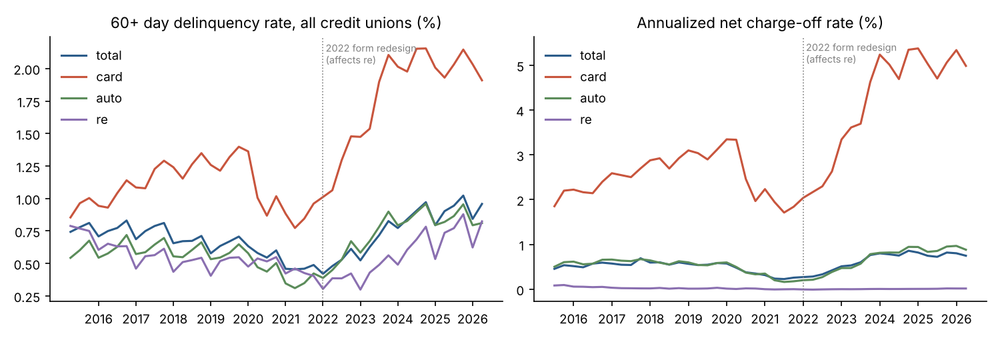
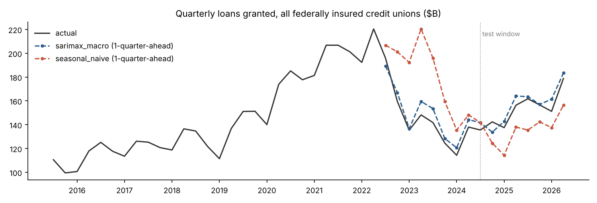

# Credit Union Loan Portfolio Forecasting (NCUA Call Report)

Forecasts new loan originations, 60+ day delinquency and net charge-offs across credit union loan portfolios. It uses 45 quarters of real regulatory filings from every federally insured U.S. credit union (2015 Q2 to 2026 Q2). The project is organized by the six CRISP-DM phases and ends in a paginated Report Builder (SSRS) report and Power BI-ready tables.

## 1. Business Understanding

A credit union's loan analytics team needs three recurring answers:

1. **Originations:** How much new lending will members take next quarter, in total and at each credit union?
2. **Delinquency and default:** Which portfolios (total, credit card, auto, real estate) are deteriorating, and what rate should we expect next quarter?
3. **Data quality:** Which reported figures look erroneous or distorted by mergers and should be corrected before they reach a report?

Success criterion: a forecast is only useful if it beats the simple rule an analyst would otherwise use. That rule is last year's same quarter for originations, and last quarter's rate for credit metrics.

## 2. Data Understanding

| Source | Content | Coverage |
|---|---|---|
| NCUA 5300 Call Report quarterly files (ncua.gov) | 56 account fields per credit union per quarter: assets, loans granted, balances, delinquency buckets and charge-offs by portfolio, members | 234,765 credit-union quarters; 6,501 credit unions; 2015 Q2 to 2026 Q2 |
| FRED (St. Louis Fed) | Unemployment rate, fed funds rate, 30-year mortgage rate, quarterly averages | 2014 Q1 to 2026 Q3 |

Findings that shaped preparation:

- **Year-to-date accounts.** Loans granted, charge-offs and recoveries are reported year-to-date, so they must be converted to quarterly flows. 2015 Q2 is the first file and has no prior quarter, so it has no quarterly flow.
- **Delinquency definition.** Delinquency is NCUA "reportable" delinquency, which means 60 or more days past due.
- **2022 call report redesign (real estate).** In 2022 Q1 NCUA replaced the real estate accounts.

  | | Through 2021 Q4 | From 2022 Q1 |
  |---|---|---|
  | Balance | All 1st mortgage plus other real estate (703 + 386) | 1-4 family residential, 1st lien plus junior lien (703A + 386A) |
  | 60+ day delinquency | Sum of the 2-6, 6-12 and 12+ month buckets for fixed and adjustable 1st mortgage and other real estate (752-754, 772-774, 756-758, 776-778) | DL0062 + DL0069 |
  | Charge-offs / recoveries | 548 + 549 / 607 + 608 | CH0017 + CH0019 / CH0018 + CH0020 |

  - **Bucket check.** The bucket sums exactly match NCUA's own pre-2022 delinquent-total fields in all 27 pre-2022 quarters: 713A + 714A for 1st mortgage, 715A + 716A for other real estate.
  - **Size of the break.** Across all credit unions, the real estate delinquency rate moved from 0.41% (2021 Q4) to 0.30% (2022 Q1). That is in line with the usual first-quarter dip, for example 0.55% to 0.42% from 2020 Q4 to 2021 Q1. So the definitional break is small relative to normal seasonality.
- **Origination by portfolio.** Loans granted are only reported as a total across portfolios, so originations are forecast in total.



## 3. Data Preparation (`src/01_prepare.py`)

- **Load:** DuckDB loads both extracts and casts the account fields.
- **Real estate splice:** Real estate accounts are spliced across the 2022 redesign. Because the break falls on a year boundary, converting year-to-date charge-offs to quarterly flows never mixes the two definitions.
- **Flows:** Year-to-date accounts are converted to quarterly flows. If a credit union's prior quarter is missing, the flow is left blank rather than guessed.
- **Rates:** Portfolio balances, 60+ day delinquency rates and annualized net charge-off rates are built for total loans, credit card, auto and real estate.
- **Anomaly flags:** Records that fail a check are logged to `data/processed/anomaly_log.csv`. Flagged rows are excluded from model training and scoring. In total, 7,527 credit-union quarters (3.2%) were flagged.

| Rule | Records | Credit unions |
|---|---|---|
| Year-to-date value fell versus the prior quarter (negative quarterly flow) | 6,444 | 2,591 |
| Robust z-score of the quarter-over-quarter change in a delinquency rate above 6 (MAD floored at 25 bp, portfolios ≥ $10M; the real estate change into 2022 Q1 is excluded because it crosses the definition break) | 2,082 | 733 |
| Assets up more than 25% in a quarter when a same-state credit union exited (suspected merger) | 210 | 198 |
| Quarterly charge-offs exceed the loan balance | 21 | 19 |
| Delinquent amount exceeds the portfolio balance | 10 | 3 |

Merger flags are heuristic and have not been checked against NCUA merger records.

## 4. Modeling

**Evaluation design (all models).**
- Every forecast is one quarter ahead, with a rolling origin.
- Each model is refit at every origin, using only data available at that point.
- Macro drivers enter from the prior quarter.
- Model choice is made on a 2022 Q3 to 2024 Q2 validation window. Results are reported on a 2024 Q3 to 2026 Q2 test window that was not used for any choice.

**Originations (`src/02_origination.py`).**
- **Industry total.** The candidates are:
  - seasonal naive
  - seasonal naive with drift
  - SARIMAX on log loans granted (AR(1), seasonal differencing with MA(1), macro drivers)
  - the two credit-union models below, summed
- **Each credit union.** Scope is credit unions with 8 contiguous prior quarters. The candidates are:
  - seasonal naive
  - LightGBM on the dollar level (Tweedie loss)
  - LightGBM on growth versus the same quarter last year: log ratio target, L1 (median) loss, forecast = last year's quarter × exp(prediction)

  The growth model matches the scoring metric (absolute error). It also lets one model learn changes across credit unions of very different sizes, instead of re-learning each one's scale.

**Delinquency and charge-offs (`src/03_credit_risk.py`).** Eight targets: next-quarter 60+ day delinquency rate and annualized net charge-off rate, for total loans, credit card, auto and real estate, per credit union.
- **Model:** LightGBM weighted by portfolio balance.
- **Features:** lagged rates (4 quarters), balance size and growth, portfolio share, prior-quarter anomaly flag, quarter of year, and macro drivers.
- **Real estate only:** the model also gets whether the quarter is on the new form and how many lagged quarters come from the old form, so it can learn the definitional jump rather than read it as credit change.
- **Scope:** portfolios of at least $10M with four contiguous prior quarters.

## 5. Evaluation

**Originations: industry total, absolute percentage error**

| Model | Validation MAPE | Test MAPE | Test worst quarter |
|---|---|---|---|
| SARIMAX with macro drivers (chosen) | 4.76% | **3.75%** | 6.73% |
| Credit-union growth model, summed | 11.84% | 7.37% | 19.97% |
| Credit-union dollar-level model, summed | 10.45% | 8.54% | 19.78% |
| Seasonal naive with drift | 20.76% | 10.75% | 23.41% |
| Seasonal naive | 26.83% | 11.59% | 16.90% |



The 2026 Q3 industry forecast is **$180.5B** in loans granted (80% interval $173.3B to $188.0B), versus $161.8B in 2025 Q3.

**Originations: each credit union, weighted absolute percentage error (WAPE)**

| Model | Validation | Test |
|---|---|---|
| Seasonal naive (same quarter last year) | 40.3% | 24.3% |
| LightGBM, dollar level | 33.9% | 31.2% |
| **LightGBM, growth vs last year (chosen)** | **26.8%** | **18.5%** |

Scored on 34,001 test credit-union quarters. The growth model cuts error by 24% versus seasonal naive on the test window. Forecasts for all 4,299 credit unions are in `outputs/origination_forecast_2026Q3_by_cu.csv`. Of these, 4,267 are modeled and 32 without 8 quarters of history fall back to seasonal naive.

Why two models: the credit-union model predicts each credit union's typical (median) outcome, which is what matters for an individual forecast. Summing medians understates the total, so SARIMAX remains the industry forecast.

**Delinquency and charge-offs: test window, balance-weighted mean absolute error (basis points)**

| Target | LightGBM | Persistence | Improvement | Credit-union quarters scored |
|---|---|---|---|---|
| 60+ day delinquency, total loans | 13.3 | 15.7 | 15.0% | 24,071 |
| 60+ day delinquency, credit card | 16.2 | 20.0 | 19.3% | 5,165 |
| 60+ day delinquency, auto | 11.5 | 13.7 | 16.5% | 19,078 |
| 60+ day delinquency, real estate | 14.1 | 19.9 | 29.5% | 17,365 |
| Net charge-off rate, total loans | 14.7 | 16.8 | 12.7% | 24,071 |
| Net charge-off rate, credit card | 48.1 | 71.5 | 32.7% | 5,165 |
| Net charge-off rate, auto | 20.1 | 26.0 | 22.7% | 19,078 |
| Net charge-off rate, real estate | 2.1 | 2.2 | 6.1% | 17,365 |

LightGBM was chosen on validation for all eight targets. It beat persistence and seasonal persistence on the test window for all eight.

**Real estate charge-offs.** Losses run at about 0.75 bp annualized across all credit unions (2023 to 2026). At that level there is almost nothing to forecast: the model's gain over persistence is small, and its error on the aggregate rate is 0.3 bp versus 0.2 bp for persistence.

Full scores, including the aggregate-rate error for every model, are in `outputs/credit_risk_backtest_scores.csv`.

## 6. Deployment

- **`reports/portfolio_risk_report.rdl`**: a paginated report for Microsoft Report Builder (SSRS).
  - It covers the 25 largest credit unions by assets.
  - It shows the last 8 quarters of 60+ day delinquency and net charge-off rates, plus the shaded 2026 Q3 forecast.
  - A Portfolio parameter switches between Total loans, Credit card, Auto and Real estate.
  - Data is embedded as XML (XML data source, blank connection string), so it runs without a database.
- **`powerbi/`**: flat tables for a Power BI dashboard. They cover industry quarterly trends, credit unions over $1B, 2026 Q3 forecasts, backtest scores and the anomaly summary.
- **`outputs/`**: backtests, model summaries and forecasts, including per-credit-union origination and credit forecasts for 2026 Q3.

## Reproduce

```bash
pip install -r requirements.txt
./run_all.sh   # about 7 minutes on CPU in testing
```

The raw data has two parts:
- `data/raw/ncua_panel.csv.gz` and `data/raw/ncua_re_panel.csv.gz` are extracts of the 45 NCUA quarterly zip files (FS220* and FOICU tables). The account lists are in `src/01_prepare.py`.
- `data/raw/fred_quarterly.csv` holds the quarterly-averaged FRED series.

## Limitations

- Every figure is a credit-union-level aggregate from regulatory filings. None of it is loan-level performance data.
- Loans granted are only reported as a total, so originations are not forecast by portfolio.
- Real estate history is spliced across a definition change. Before 2022 it covers all 1st mortgage and other real estate; from 2022 it covers 1-4 family residential 1st and junior liens. The model is told which form each quarter comes from, but the two series are not identical.
- Merger detection is a heuristic. Quarterly flows for credit unions that absorbed another credit union mid-year may still be distorted where the flag missed them.
